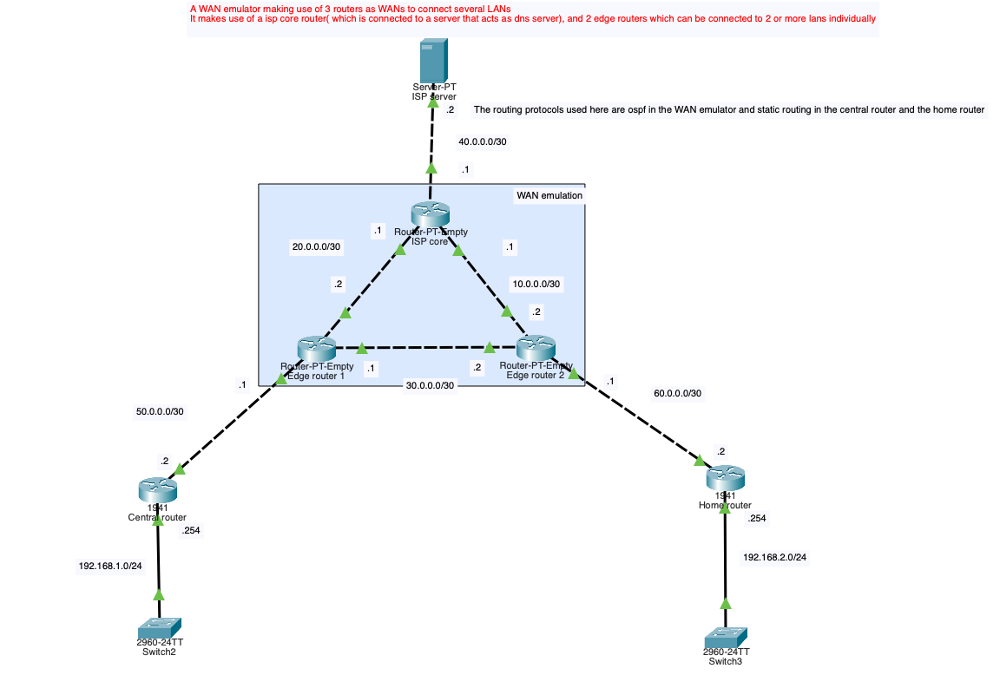

# Network Engineer Portfolio

Welcome to my Network Engineering Portfolio repository! 

This repository showcases a curated collection of hands-on **Cisco Packet Tracer labs**, network configurations, and practical implementations. It serves as tangible evidence of my skills, troubleshooting methodologies, and practical knowledge as an aspiring / junior **Network Engineer** actively seeking opportunities in network engineering, operations (NOC), and infrastructure roles.

---

## About This Portfolio

As someone looking to make an immediate impact on an engineering team, I believe the best way to demonstrate competence is through practical, working topologies and reproducible network designs. 

Each lab project in this repository illustrates core networking competencies:
- **Design & IP Schemes:** Subnetting (CIDR/VLSM), IP addressing plans, and address conservation.
- **Routing & Switching:** Inter-VLAN routing, Router-on-a-Stick, static routing, and dynamic routing protocols.
- **Network Segmentation & Security:** VLANs, access-lists (ACLs), and traffic segmentation.
- **Diagnostics & Troubleshooting:** Layer 1–Layer 4 connectivity verification using `ping`, `traceroute`, and Cisco IOS diagnostic show commands.

---

## Projects & Labs

### 1. [Mini WAN Emulator Core Mesh & Edge Interconnect](mini-wan-emulator/README.md)
A multi-site WAN architecture emulating an ISP core network. It demonstrates OSPF Area 0 routing across a redundant triangular backbone, point-to-point `/30` serial/routed links, default routing at edge customer premises equipment (CPE), and centralized hosted ISP DNS services.

- **Key Focus Areas:** OSPF Area 0, WAN Core Mesh Emulation, Point-to-Point `/30` Subnets, Default Routing (`0.0.0.0/0`), Dynamic Failover, DNS/ISP Server Integration.
- **Documentation & Lab:** [View Full Mini WAN Emulator Documentation & Guide →](mini-wan-emulator/README.md)

---

### 2. [Multi-Layer Switch (L3) Inter-VLAN Routing & VLSM](multi-layer-switch-intervlan-routing/README.md)
An enterprise campus switching implementation demonstrating Layer 3 switching, Switch Virtual Interfaces (SVIs), routed ports (`no switchport`), 802.1Q trunking, and Variable Length Subnet Masking (VLSM) across departmental VLANs.

- **Key Focus Areas:** MLS / Layer 3 Switching, SVIs, 802.1Q Encapsulation, Routed Ports (`no switchport`), VLSM (`/28`, `/30`), Inter-VLAN Routing.
- **Documentation & Lab:** [View Full Multi-Layer Switch Documentation & Guide →](multi-layer-switch-intervlan-routing/README.md)

---

### 3. [Subnet Design & Inter-Subnet Routing](subnet-routing/README.md)
A foundational network engineering lab focused on IPv4 subnet allocation, classless IP calculations, default gateway setups, and multi-network segmentation routing.

- **Key Focus Areas:** IPv4 Subnetting, Gateway Configuration, Inter-Segment Routing, Packet Tracer Topology (`.pkt`).
- **Documentation & Lab:** [View Full Subnet Routing Documentation & Guide →](subnet-routing/README.md)

---

---

## Tools & Technologies

- **Simulation & Lab Tools:** Cisco Packet Tracer.
- **Hardware/Operating Systems:** Cisco IOS, Layer 2 / Layer 3 Switches, Routers
- **Protocols & Concepts:** IPv4/IPv6, Subnetting (VLSM), VLANs/Trunking (802.1Q), Inter-VLAN Routing, Static & Dynamic Routing, DHCP, NAT, ACLs

---

## Contact & Opportunities

I am actively open to:
- **Junior Network Engineer**
- **NOC / Network Support Technician**
- **Network Administrator / Infrastructure Support** roles

If you are a hiring manager or recruiter looking for a dedicated network engineer with strong foundational problem-solving skills and hands-on practice, feel free to reach out or explore the labs here!
