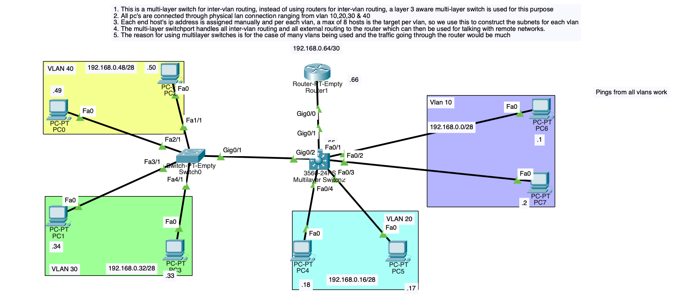

# Multi-Layer Switch Inter-VLAN Routing Lab

A Cisco Packet Tracer implementation demonstrating Layer 3 Inter-VLAN routing using a Multi-Layer Switch (MLS / Cisco Catalyst 3560), trunking, custom VLSM IP subnet planning, and routed uplink connection to an external edge router.

---

## Topology Overview



---

## Project Overview & Objective

In this lab, a Layer 3-capable **Multi-Layer Switch (Cisco Catalyst 3560)** was chosen to perform internal Inter-VLAN routing across multiple segmented broadcast domains (VLANs 10, 20, 30, and 40), while connecting upstream to an edge router via a routed port for external / remote destination routing.

### Key Implementation Highlights
- **Layer 3 Core/Distribution Inter-VLAN Routing:** Using Switch Virtual Interfaces (SVIs) on the 3560 Multi-Layer Switch to route traffic at wire-speed locally.
- **Custom Subnet Sizing (VLSM):** Tailored subnets to support a target maximum of 8 usable hosts per VLAN using `/28` blocks (14 usable hosts each) to conserve IPv4 space.
- **Layer 2 Access & Trunk Integration:** Switch0 carries VLAN 30 and VLAN 40 traffic over an 802.1Q trunk link to the MLS, while VLAN 10 and VLAN 20 connect directly to access ports on the MLS.
- **Routed Uplink (Point-to-Point):** The MLS interfaces with the perimeter router (`Router1`) via a routed point-to-point `/30` link (`no switchport`), offloading internal LAN routing from the router.
- **Full Inter-VLAN Connectivity:** Verified end-to-end reachability via ICMP (`ping`) across all VLANs and routed interfaces.

---

## Architectural Decision: Multi-Layer Switch (MLS) vs. Traditional Router

A core design decision in this topology is using a **Multi-Layer Switch (Layer 3 Switch)** for inter-VLAN routing instead of relying on a traditional router (e.g., Router-on-a-Stick).

### Why use a Multi-Layer Switch?

1. **Hardware-Based Packet Switching (ASIC Performance & Wire-Speed Throughput):**
   - Multi-layer switches use specialized hardware called **ASICs (Application-Specific Integrated Circuits)** and Cisco Express Forwarding (CEF) to route packets in silicon at wire-speed.
   - In contrast, routers primarily use software/general-purpose CPUs for routing decisions, which creates a performance bottleneck under heavy local traffic loads.

2. **Elimination of the "Router-on-a-Stick" Bandwidth Bottleneck:**
   - With traditional Router-on-a-Stick (RoaS), all inter-VLAN traffic must travel up a single physical trunk link to the router, get processed, and travel back down the exact same trunk.
   - When handling multiple active VLANs and heavy intra-campus east-west traffic (e.g., file transfers, internal servers, database queries), the RoaS physical link quickly becomes congested. The MLS eliminates this bottleneck completely.

3. **Port Density and Cost Efficiency:**
   - Multi-layer switches provide high port density (e.g., 24 or 48 Gigabit/FastEthernet ports) capable of switching and routing concurrently.
   - Equipping dedicated routers with equivalent high-speed interface counts is significantly more expensive and less scalable.

4. **Lower Latency for Local East-West Traffic:**
   - Intra-LAN / inter-VLAN traffic is switched and routed internally on the switch backplane within nanoseconds to low microseconds, ensuring lower latency compared to traversing external router hops.

5. **Proper Separation of LAN Routing vs. WAN/Edge Routing:**
   - **Multi-Layer Switch:** Manages high-volume **East-West** internal traffic between local VLANs.
   - **Router (`Router1`):** Retains its specialized purpose—managing **North-South** WAN edge traffic, NAT, firewalling, VPN tunnels, and WAN connections to remote networks.

---

## IP Addressing & VLAN Scheme

Per design criteria, each VLAN was calculated to accommodate a target maximum of **8 hosts per VLAN**. Using VLSM, a `/28` subnet mask (`255.255.255.240`) was chosen, providing 16 IP addresses (14 usable host addresses) per VLAN—perfectly fulfilling the host capacity with room for growth while avoiding address waste.

| VLAN ID | Name / Description | Subnet Address | Subnet Mask | Usable Host Range | Default Gateway (SVI IP) |
|:---:|:---:|:---:|:---:|:---:|:---:|
| **VLAN 10** | Segment 10 (PC6, PC7) | `192.168.0.0/28` | `255.255.255.240` | `192.168.0.1 - 192.168.0.14` | `192.168.0.14` (or SVI) |
| **VLAN 20** | Segment 20 (PC4, PC5) | `192.168.0.16/28` | `255.255.255.240` | `192.168.0.17 - 192.168.0.30` | `192.168.0.30` (or SVI) |
| **VLAN 30** | Segment 30 (PC1, PC3) | `192.168.0.32/28` | `255.255.255.240` | `192.168.0.33 - 192.168.0.46` | `192.168.0.46` (or SVI) |
| **VLAN 40** | Segment 40 (PC0, PC2) | `192.168.0.48/28` | `255.255.255.240` | `192.168.0.49 - 192.168.0.62` | `192.168.0.62` (or SVI) |
| **Uplink** | MLS <-> Router1 Link | `192.168.0.64/30` | `255.255.255.252` | `192.168.0.65 - 192.168.0.66` | MLS: `.65` / Router: `.66` |

---

## Configuration Walkthrough & Core Concepts

### 1. Enabling IP Routing on the Multi-Layer Switch
By default, Cisco Catalyst switches operate as Layer 2 devices. Routing must be explicitly enabled:
```cisco
MultilayerSwitch(config)# ip routing
```

### 2. Creating VLANs and Switch Virtual Interfaces (SVIs)
Each VLAN is configured with an SVI that acts as the default gateway for hosts within that broadcast domain:
```cisco
! Configure VLANs
MultilayerSwitch(config)# vlan 10
MultilayerSwitch(config-vlan)# vlan 20
MultilayerSwitch(config-vlan)# vlan 30
MultilayerSwitch(config-vlan)# vlan 40
MultilayerSwitch(config-vlan)# exit

! Configure SVIs (Gateways)
MultilayerSwitch(config)# interface vlan 10
MultilayerSwitch(config-if)# ip address 192.168.0.14 255.255.255.240
MultilayerSwitch(config-if)# no shutdown

MultilayerSwitch(config)# interface vlan 20
MultilayerSwitch(config-if)# ip address 192.168.0.30 255.255.255.240
MultilayerSwitch(config-if)# no shutdown

MultilayerSwitch(config)# interface vlan 30
MultilayerSwitch(config-if)# ip address 192.168.0.46 255.255.255.240
MultilayerSwitch(config-if)# no shutdown

MultilayerSwitch(config)# interface vlan 40
MultilayerSwitch(config-if)# ip address 192.168.0.62 255.255.255.240
MultilayerSwitch(config-if)# no shutdown
```

### 3. Layer 2 Switch Trunking & Access Ports
- **Gig0/2 on MLS <-> Gig0/1 on Switch0:** Configured as an 802.1Q trunk link to carry tags for VLAN 30 and VLAN 40.
- **Switch0 Access Ports:**
  - `Fa2/1` & `Fa1/1`: Assigned to VLAN 40 (`PC0`, `PC2`).
  - `Fa3/1` & `Fa4/1`: Assigned to VLAN 30 (`PC1`, `PC3`).
- **MLS Access Ports:**
  - `Fa0/1` & `Fa0/2`: Assigned to VLAN 10 (`PC6`, `PC7`).
  - `Fa0/3` & `Fa0/4`: Assigned to VLAN 20 (`PC4`, `PC5`).

### 4. Routed Uplink Port (`no switchport`)
To connect the MLS to `Router1`, the physical switchport is converted into a routed Layer 3 interface:
```cisco
MultilayerSwitch(config)# interface gig0/1
MultilayerSwitch(config-if)# no switchport
MultilayerSwitch(config-if)# ip address 192.168.0.65 255.255.255.252
MultilayerSwitch(config-if)# no shutdown
```

And configured on `Router1`:
```cisco
Router1(config)# interface gig0/0
Router1(config-if)# ip address 192.168.0.66 255.255.255.252
Router1(config-if)# no shutdown
```

---

## Verification & Diagnostics

To verify the topology state, routing tables, and connectivity:

```cisco
! Verify Layer 3 routing is active and check the routing table
MultilayerSwitch# show ip route

! Verify SVI and physical interface IP status
MultilayerSwitch# show ip interface brief

! Verify VLAN database and port assignments
MultilayerSwitch# show vlan brief

! Verify trunk interfaces
MultilayerSwitch# show interfaces trunk
```

### Connectivity Tests
- **Intra-VLAN:** Ping between hosts in the same VLAN (e.g., `PC6` -> `PC7`).
- **Inter-VLAN:** Ping across different VLANs (e.g., `PC0` [VLAN 40: `192.168.0.49`] -> `PC6` [VLAN 10: `192.168.0.1`]).
- **Gateway & Uplink:** Ping default gateways and the router point-to-point interface (`192.168.0.66`).

---

## Repository Contents

- [`multiLayer-switch-inter-vlan.pkt`](multiLayer-switch-inter-vlan.pkt): Packet Tracer project topology file.
- [`image.png`](image.png): Annotated topology diagram showing IP addressing, VLAN segmentation, and device connections.
- [`README.md`](README.md): Detailed documentation of design choices, addressing scheme, and setup commands.
